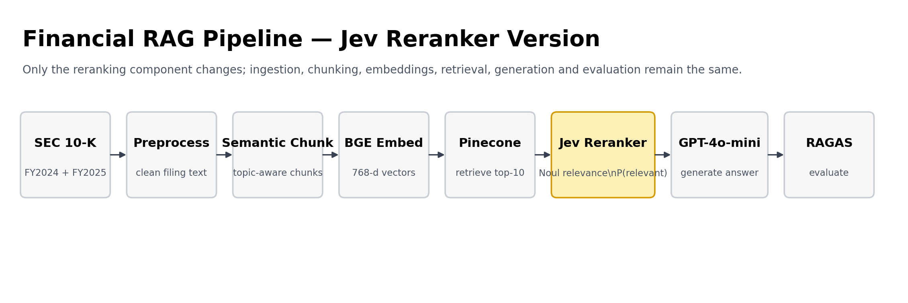

**Additional API key required:** `TYPESAFE_API_KEY`

**Reranking pattern:** Pinecone top-k → query + candidates as Jev state → one `Noul` relevance question per candidate → `TypeSafeClient.system_one(...)` → Python sorts by `P(relevant)` → top-n context.

# Financial RAG Pipeline — Student Solution Kit

A guide for students building an end-to-end Retrieval-Augmented Generation (RAG) pipeline over financial documents. The pipeline ingests real SEC 10-K filings, compares two chunking strategies, adds a reranking step, and evaluates everything formally using RAGAS metrics.

This document explains every component, why each design decision was made, how data flows from raw SEC filing to final answer, and what the evaluation numbers actually mean. You should be able to understand the full working of this system without ever reading the code.

---

## What students are building

A program that takes a natural language financial question — such as "What was Apple's total net revenue in fiscal year 2024?" — and returns a grounded, accurate answer sourced directly from Apple's SEC 10-K filings. The system must:

1. **Ingest real financial documents** from SEC EDGAR automatically, with no manual download
2. **Chunk documents two different ways** (fixed-size and semantic) and store both in a vector database under separate namespaces
3. **Retrieve relevant passages** using embedding similarity search
4. **Rerank the candidates** using TypeSafe AI Jev, which evaluates each retrieved candidate for direct usefulness to the query
5. **Generate a grounded answer** using an LLM that is instructed to use only the retrieved context
6. **Evaluate the pipeline formally** using RAGAS — measuring faithfulness, context precision, and context recall across three experiment configurations

The final deliverable is a working notebook with a comparison report showing which configuration performs best and why.

---

## Architecture



The architecture diagram above shows seven logical phases. Data enters at the top (SEC EDGAR), flows downward through preprocessing and two parallel chunking paths, converges in Pinecone, passes through retrieval and optional reranking, reaches the LLM for generation, and finally feeds into RAGAS evaluation. The winner is identified at the bottom.

The two parallel paths — fixed-size and semantic chunking — are the core comparison of the project. Everything else (embedding, retrieval, reranking, generation, evaluation) is identical between the two paths, which makes the comparison clean and fair.

---

## How data flows — end to end

Understanding the data flow is the most important thing before reading any code. Here is exactly what happens to a document from the moment it is downloaded to the moment an answer appears.

**Step 1 — Download.** `sec-edgar-downloader` pulls Apple's 10-K filings from the SEC EDGAR database as `.txt` files. Each file is the full EDGAR submission package — a single large text file (~9MB each) containing the complete annual report bundled with EDGAR filing metadata.

**Step 2 — Load.** LangChain's `TextLoader` reads each file and wraps it in a `Document` object. The file path is tagged as metadata on the document so we can trace which filing each chunk came from later.

**Step 3 — Clean.** The raw text contains SGML tags (`<SEC-DOCUMENT>`, `<TYPE>`), HTML entities (`&#160;` for non-breaking space, `&#9746;` for checkboxes), XBRL data fragments, and a multi-line filing header (accession numbers, company CIK, form type). Two cleaning functions handle this:
- `clean_edgar_text` decodes HTML entities, strips remaining tags, removes XBRL artifacts, and collapses whitespace
- `remove_edgar_header` skips everything before "UNITED STATES SECURITIES AND EXCHANGE COMMISSION" — the actual 10-K cover page

After cleaning, the two filings total approximately 7.6 million characters of readable financial text.

**Step 4 — Chunk (two parallel paths).** The cleaned documents are split two different ways. Path A uses fixed-size chunking. Path B uses semantic chunking. The chunks from each path are stored in a separate Pinecone namespace so they can be queried independently.

**Step 5 — Embed.** Every chunk (from both paths) is passed through `BAAI/bge-base-en-v1.5`, a HuggingFace embedding model that produces a 768-dimensional dense vector representing the semantic meaning of the chunk. These vectors are what Pinecone uses for similarity search.

**Step 6 — Store.** The vectors and their associated text are uploaded to Pinecone. Fixed-size chunks go to `namespace="fixed"` (12,142 vectors). Semantic chunks go to `namespace="semantic"` (2,529 vectors). Pinecone stores both the vectors and the original text as metadata.

**Step 7 — Retrieve.** At query time, the user's question is embedded using the same model. Pinecone performs a cosine similarity search and returns the top-k most similar chunks from the requested namespace. This is the bi-encoder retrieval step — fast but approximate.

**Step 8 — Rerank (optional).** If reranking is enabled, the top-10 candidates from Pinecone are passed to a Jev (`Jev System One` via TypeSafe AI Jev). Unlike the bi-encoder, Jev receives the query and retrieved candidates as System One state. A typed `Noul` relevance question is evaluated for each candidate, and Python sorts the candidates by the returned `P(relevant)` values. The top-3 are returned.

**Step 9 — Generate.** The top-3 chunks are formatted into a context string and injected into a prompt template alongside the original question. The prompt instructs `gpt-4o-mini` to answer only from the provided context. The LLM generates a grounded answer with specific figures.

**Step 10 — Evaluate.** For formal evaluation, 10 questions with known ground truth answers are run through all three pipeline configurations (A: fixed, B: semantic, C: semantic + rerank). RAGAS scores each configuration on faithfulness, context precision, and context recall.

---

## Component-by-component explanation

### Data Ingestion — SEC EDGAR

**What it is.** The SEC (Securities and Exchange Commission) publishes all public company filings on its EDGAR database. Apple's annual report (Form 10-K) is a legal requirement and is publicly available. `sec-edgar-downloader` is a Python library that downloads these filings programmatically.

**What we download.** Apple's 10-K for FY2024 (filed October 2024) and FY2025 (filed October 2025). Each is the company's comprehensive annual financial report — typically 100+ pages covering revenue, risk factors, management discussion and analysis (MD&A), financial statements, and segment performance.

**Why two years.** Having two filings gives the pipeline real retrieval challenges: both documents cover overlapping topics (supply chain risks, services revenue, EPS) but with different numbers. The retrieval system must find the right year's data, not just any mention of "revenue."

**Why 10-K.** Annual reports are dense, structured, and information-rich — they test every weakness of naive RAG systems. Tables, risk factor lists, multi-paragraph analyses, and cross-references all appear within the same document. This is a harder and more realistic test than short articles or FAQs.

---

### Text Preprocessing

**Why preprocessing is necessary.** EDGAR full-submission files are not clean text. They are multi-part SGML documents containing the filing header, HTML-formatted content, inline XBRL data tags, and encoded characters. Sending raw EDGAR text to an embedding model would produce poor-quality vectors because the model would waste capacity on structural noise.

**`clean_edgar_text` — what it does.**
- Decodes HTML entities: `&#160;` becomes a space, `&#9746;` becomes a checkmark character
- Strips remaining SGML/HTML tags using regex: `<[^>]+>` matches any tag
- Removes XBRL inline data fragments: `ix:nonfraction`, `ix:nonnumeric` tags and their attributes
- Collapses runs of three or more newlines to two (preserves paragraph breaks)
- Collapses runs of three or more spaces to one

**`remove_edgar_header` — what it does.** The filing metadata at the top of each file (accession numbers, form type, company CIK, business address) is not financial content. We find the first occurrence of "UNITED STATES SECURITIES AND EXCHANGE COMMISSION" — the actual start of the 10-K cover page — and discard everything before it. This removes ~2,000 characters of boilerplate per filing.

---

### Chunking Strategy A — Fixed-Size

**What it is.** `RecursiveCharacterTextSplitter` splits text by trying a list of separators in order: paragraph breaks (`\n\n`), then line breaks (`\n`), then sentence endings (`. `), then spaces, then individual characters as a last resort. The target chunk size is 512 characters with a 64-character overlap between adjacent chunks.

**What "overlap" means.** The last 64 characters of chunk N also appear at the start of chunk N+1. This prevents context from being completely cut at a boundary — a sentence that starts near the end of one chunk is partially repeated at the beginning of the next.

**Why it is a baseline, not a solution for financial docs.** The 512-character limit is agnostic to meaning. Apple's revenue table looks like this in the filing:

```
iPhone $ 201,183  --  %  $ 200,583  (2) %  $ 205,489
Mac 29,984  2  %  29,357  (27) %  40,177
Total net sales $ 391,035  2  %  $ 383,285
```

A 512-character window cuts this table at an arbitrary point. One chunk might contain `$ 391,035` with no column headers. Another might contain `Total net sales` with no numbers. Neither chunk alone answers "What was Apple's total revenue?" The embedding model cannot produce a useful vector from a fragment with no context.

This is confirmed in the RAGAS results: Context Precision = 0.00 and Context Recall = 0.00.

**Noise filtering.** After splitting, chunks shorter than 100 characters or with fewer than 40% alphabetic characters are dropped. This removes pure-number table fragments, checkbox lines, and page headers that would otherwise pollute the vector store.

---

### Chunking Strategy B — Semantic

**What it is.** `SemanticChunker` (from `langchain-experimental`) embeds each sentence individually and measures the cosine distance between adjacent sentence embeddings. When the distance spikes above a threshold — indicating a topic shift — a chunk boundary is placed there.

**The breakpoint threshold.** We use `breakpoint_threshold_type="percentile"` with `breakpoint_threshold_amount=65`. This means a boundary is placed wherever the sentence-to-sentence distance exceeds the 65th percentile of all distances in the document. In practice, this means boundaries appear at section transitions (Risk Factors → MD&A → Financial Statements) and at major topic changes within a section.

**Threshold tuning — why 65.** The right threshold depends on how varied the writing style is. Financial documents are formal and consistent, so the distance distribution is compressed — most adjacent sentences are topically close. A high threshold (95th percentile) produced only 400 chunks averaging 13,050 characters each — far too large for precise retrieval. Iterating down to the 65th percentile produced 2,245 chunks averaging 2,246 characters — large enough to carry complete financial thoughts, small enough to pinpoint specific facts.

| Threshold | Chunks | Avg Length | Issue |
|---|---|---|---|
| 95th | 400 | 13,050 chars | Entire sections in one chunk |
| 80th | 1,400 | 3,656 chars | Still too large |
| 70th | 1,971 | 2,568 chars | Improving |
| 65th | 2,245 | 2,246 chars | Good — used in production |

**Pinecone metadata limit handling.** Pinecone stores chunk text in vector metadata with a 40KB limit per vector. Some semantic chunks — particularly those covering long financial statements — exceeded this limit (up to 108KB). Any chunk over 8,000 characters is split further using `RecursiveCharacterTextSplitter` before upload. This secondary split produced 284 additional sub-chunks, bringing the final count to 2,529.

**Why semantic chunking wins on financial documents.** Apple's revenue table stays in one chunk because the sentences describing it are semantically similar — they all mention product names, dollar amounts, and year-over-year comparisons. The chunk boundary appears after the table, not in the middle of it. When the retriever searches for "total net revenue 2024," the retrieved chunk contains the full table with headers and totals.

---

### Embedding — BAAI/bge-base-en-v1.5

**What it is.** A bi-encoder sentence transformer from Beijing Academy of Artificial Intelligence. It maps any text passage to a 768-dimensional float vector. Passages with similar semantic meaning produce vectors that are close in cosine distance.

**Why this model.** It performs well on factual retrieval tasks, is free to use, and runs locally via `sentence-transformers`. The `bge` (BAAI General Embedding) family consistently ranks near the top on MTEB (Massive Text Embedding Benchmark) retrieval tasks. The base variant (440MB) is a good balance of quality and speed for a learning project.

**The instruction prefix trick.** BGE models are designed to work with an instruction prefix on query embeddings: `"Represent this sentence for searching relevant passages: "`. LangChain handles this automatically when `normalize_embeddings=True` is set. It tells the model that the input is a search query, not a passage — producing slightly better retrieval.

**GPU requirement.** Embedding 12,142 or 2,529 chunks on CPU takes 30-40 minutes. On a T4 GPU (Google Colab free tier), the same operation finishes in 3-5 minutes. The model itself is identical — only the compute backend changes.

---

### Vector Store — Pinecone

**What it is.** Pinecone is a managed vector database. It stores dense vectors alongside metadata (the original text and source file path) and supports fast approximate nearest-neighbor search. We use the serverless tier which is free.

**Two namespaces.** A Pinecone index can contain multiple namespaces — logically separate partitions within the same index. We use `namespace="fixed"` for the 12,142 fixed-size chunk vectors and `namespace="semantic"` for the 2,529 semantic chunk vectors. Querying a specific namespace returns results only from that partition, enabling a controlled A/B comparison.

**Dimension = 768.** The index must be created with a dimension matching the embedding model output. BAAI/bge-base-en-v1.5 produces 768-dimensional vectors. Metric = cosine means similarity is measured as the angle between vectors — normalized vectors make this equivalent to dot product.

**Batch upload.** Chunks are uploaded 100 at a time. Uploading all 12,142 fixed chunks at once would exceed Pinecone's request size limit and potentially trigger rate limiting. Each batch is embedded, formatted, and upserted before the next batch begins.

---

### Retrieval — Bi-Encoder (Pinecone Similarity Search)

**What it is.** At query time, the user's question is embedded using the same `BAAI/bge-base-en-v1.5` model. Pinecone computes the cosine similarity between the query vector and all stored chunk vectors in the requested namespace, returning the top-k most similar chunks.

**Why it is fast but approximate.** The bi-encoder embeds query and chunk independently and compares their vector representations. It never sees query and chunk together. This allows pre-computation of all chunk embeddings (done during ingestion) and makes retrieval fast — a single vector lookup operation. The trade-off is that it can surface chunks that are semantically adjacent to the query topic but not directly answering it.

**Candidate pool for reranking.** When reranking is enabled, we retrieve k=10 candidates instead of k=3. The extra candidates give the reranker a larger pool to re-order. If we only retrieved k=3 candidates, the reranker could only choose among those three — the improvement would be minimal.

---

### Reranking — Jev (TypeSafe AI Jev)

**What it is.** A Jev is a transformer model that takes the full (query, chunk) pair as input and outputs a single relevance score. Unlike the bi-encoder which scores query and chunk separately, the Jev sees them together — allowing it to model their interaction directly.

**The model.** TypeSafe AI Jev is used through the `typesafe-sdk` and requires a `TYPESAFE_API_KEY`. The reranking task is expressed as a set of narrow System One `Noul` questions. Each question asks whether a retrieved candidate is directly relevant and useful for answering the financial query. Jev returns a probability for the positive decision, and normal Python code performs the final sort.

**The two-stage pipeline.**
1. **Stage 1 (bi-encoder):** Retrieve top-10 candidates from Pinecone using embedding similarity. Fast, ~100ms.
2. **Stage 2 (Jev):** Send the query and 10 retrieved candidates as state, evaluate one typed relevance question per candidate, sort the returned `P(relevant)` values, and return the top-3.

**Why the Jev is more accurate.** Consider the query "What was Apple's net revenue in fiscal year 2024?" The bi-encoder might retrieve a chunk containing "Total net sales $ 383,285" (FY2023 data) because its vector is semantically close to "revenue 2024." The Jev sees "fiscal year 2024" and "$ 383,285" together and recognizes the year mismatch — it scores this chunk lower and elevates a chunk containing "$391,035" from the FY2024 filing.

**The reranker limitation.** The reranker can only re-order what the bi-encoder already retrieved. If the right chunk was not in the top-10 Pinecone results, no amount of reranking can surface it. For the R&D spend query, neither approach retrieved the R&D expense line from the income statement in the early testing phases — the fix was widening the candidate pool from k=5 to k=10.

---

### Answer Generation — RAG Chain

**What it is.** A LangChain LCEL (LangChain Expression Language) chain that combines a prompt template, an LLM, and an output parser into a single callable pipeline.

**The prompt template.**
```
You are a financial analyst assistant. Answer the question using ONLY the context provided below.
If the context does not contain enough information to answer, say "I don't have enough context to answer this."
Always cite specific numbers and figures when available.

Context:
{context}

Question: {question}

Answer:
```

The key instruction is "ONLY the context provided below." This is what prevents hallucination — the model is explicitly forbidden from using prior knowledge. When the context contains the right information, the model answers precisely. When it doesn't, it says so rather than making something up. This is what RAGAS measures with the Faithfulness metric.

**The LLM.** `gpt-4o-mini` from OpenAI, called via LangChain's `ChatOpenAI` wrapper with `temperature=0`. Temperature zero means deterministic output — the model always picks the highest-probability token, producing consistent answers across repeated runs.

**Context assembly.** The top-3 retrieved (and optionally reranked) chunks are joined with separator lines (`---`) and inserted into the `{context}` placeholder. The total context typically runs 2,000–6,000 characters for semantic chunks.

---

### RAGAS Evaluation

**What it is.** RAGAS (Retrieval-Augmented Generation Assessment) is an open-source framework for evaluating RAG pipelines. It uses an LLM as a judge to score answers against retrieved contexts and ground truth answers.

**The evaluation dataset.** 10 questions with ground truth answers manually verified from Apple's 10-K filings. The ground truth answers are based on numbers that appear in the actual SEC filings — they are not guessed or approximated.

**The three experiments.**

| Label | Chunking | Reranking | Description |
|---|---|---|---|
| A | Fixed-size | No | Baseline: naive chunking |
| B | Semantic | No | Hypothesis: semantic chunking is better |
| C | Semantic | Yes | Full pipeline: semantic + reranking |

**The three metrics.**

**Faithfulness** measures whether the generated answer is grounded in the retrieved context. RAGAS identifies each factual claim in the answer and checks whether it can be inferred from the retrieved chunks. A score of 1.0 means every claim in the answer is supported by context. A score of 0.75 means 25% of claims in the answer are not supported — they came from the model's prior knowledge (hallucination).

**Context Precision** measures whether the retrieved chunks are relevant to the question. For each retrieved chunk, RAGAS asks: "Is this chunk useful for answering the question?" A score of 0.00 means none of the retrieved chunks were useful. A score of 0.95 means 95% of retrieved chunks were relevant.

**Context Recall** measures whether the retrieval found everything needed to answer the question fully. RAGAS compares the retrieved context against the ground truth answer and asks: "Could someone have generated this ground truth answer from the retrieved chunks?" A score of 1.00 means the retrieved chunks contain all the information present in the ground truth. A score below 1.00 means some information needed for the ground-truth answer was not present in the retrieved context.

**The RAGAS judge LLM.** RAGAS uses `gpt-4o-mini` (configured via `LangchainLLMWrapper`) to make these judgments. It also uses OpenAI embeddings (`text-embedding-3-small`) internally for its answer relevancy metric. This is separate from the HuggingFace embeddings used for Pinecone retrieval.

---

## Results and what they mean

```
           Metric  A: Fixed (no rerank)  B: Semantic (no rerank)  C: Semantic + Jev Reranking
     Faithfulness                  0.400                    0.900                    0.967
Context Precision                  0.000                    0.750                    1.000
   Context Recall                  0.000                    0.800                    1.000
```

**Experiment A (Fixed, no rerank):** Context Precision and Context Recall are both 0.000, while Faithfulness is 0.400. The fixed-size chunks do not preserve enough of the financial context needed for reliable retrieval and grounded generation.

**Experiment B (Semantic, no rerank):** Semantic chunking improves the pipeline substantially. Context Precision reaches 0.750, Context Recall reaches 0.800, and Faithfulness reaches 0.900.

**Experiment C (Semantic + Jev rerank):** Jev reranking improves the semantic pipeline further. Context Precision reaches 1.000, Context Recall reaches 1.000, and Faithfulness reaches 0.967. The reranked context is both highly relevant and complete for the evaluation set.

**The key insight.** Chunking strategy determines whether retrieval is even possible. No amount of reranking, prompt engineering, or LLM power can compensate for a chunking strategy that destroys the information content of financial tables. Fix the chunking first. Reranking then provides a meaningful incremental improvement.

---

## Why this design, not another

**Why two Pinecone namespaces instead of two indexes?** One index with two namespaces requires only one index on Pinecone's free tier (which allows a single index). It also allows the same index connection object to query both, making the code simpler.

**Why TypeSafe AI Jev for reranking?** Reranking is a bounded decision problem: each retrieved passage needs to be judged for how directly it helps answer the query. Jev expresses this as typed System One relevance decisions and returns probabilities that Python can use for ranking. The pipeline therefore keeps retrieval and sorting in code while Jev handles the relevance judgment.

**Why OpenAI for generation and RAGAS, but HuggingFace for embeddings?** HuggingFace embeddings are free and run locally — ideal for embedding tens of thousands of chunks. OpenAI provides the generation quality needed for accurate answers on financial questions and is the LLM that RAGAS integrates most reliably with (avoiding the `n>1` parameter error that occurs with Groq on RAGAS's answer relevancy metric).

**Why 10 evaluation questions, not 100?** RAGAS calls the judge LLM 3 times per question per experiment (once per metric). 10 questions × 3 experiments × 3 metrics = 90 LLM calls. At `gpt-4o-mini` pricing, this costs less than $0.10. 100 questions would cost $1.00 and take significantly longer — unnecessary for a learning project where the directional signal is clear at 10 questions.

---

## Reference reading

- LangChain SemanticChunker: `langchain_experimental.text_splitter.SemanticChunker`
- LangChain RecursiveCharacterTextSplitter: `langchain.text_splitter.RecursiveCharacterTextSplitter`
- Pinecone namespaces: [docs.pinecone.io/guides/indexes/use-namespaces](https://docs.pinecone.io/guides/indexes/use-namespaces)
- RAGAS metrics: [docs.ragas.io/en/latest/concepts/metrics](https://docs.ragas.io/en/latest/concepts/metrics/)
- TypeSafe AI Jev Jev: [github.com/PrithivirajDamodaran/TypeSafe AI Jev](https://github.com/PrithivirajDamodaran/TypeSafe AI Jev)
- BAAI/bge-base-en-v1.5: [huggingface.co/BAAI/bge-base-en-v1.5](https://huggingface.co/BAAI/bge-base-en-v1.5)
- SEC EDGAR Downloader: [pypi.org/project/sec-edgar-downloader](https://pypi.org/project/sec-edgar-downloader/)
- MTEB Leaderboard (embedding model rankings): [huggingface.co/spaces/mteb/leaderboard](https://huggingface.co/spaces/mteb/leaderboard)
